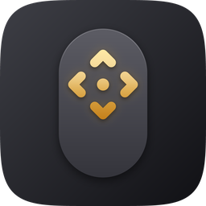

<p align="center">
  
</p>

# Extra Magic Mouse

A free menu bar app that turns Magic Mouse touch gestures into **held arrow keys**,
for panning the camera in RTS games without pushing the pointer to the edge of the screen.

Rest two fingers on the mouse and push them forward, back, left or right. The matching
arrow key stays held for as long as you hold that direction, and diagonals work too.
Lift your fingers and the key is released.

## Features

- **Joystick mode** (default): push from where you first touched and hold to keep panning.
- **Drag mode**: panning happens only while your fingers are moving.
- **Pan With**: arrow keys, WASD, or **Middle Mouse Drag**, which holds the middle button
  and moves the pointer for games that let you grab and drag the map. In Joystick
  mode, middle-mouse panning works like an analog stick: push further to pan faster.
  The pointer goes back where it started when you lift.
- **Fast Pan**: push far toward the edge of the mouse and it also holds Shift, Control,
  Option, Command or any key you pick, for games with a "pan faster" key.
- **Gestures**: each can send a key (any key or combination, like ⌃1), a middle click,
  or a scroll:
  - Two-finger tap (off by default)
  - Three-finger tap (default: middle click)
  - Left-edge and right-edge one-finger tap (off by default)
  - Pinch in / out (default: scroll down / up, which zooms in most games)

  A real click is never mistaken for a tap, and fingers resting on the mouse
  don't block a tap.
- **Per-game settings**: switch to a game and turn on **Own Settings for "‹game›"**.
  Every setting in the menu then applies to that game only.
- 1-finger or 2-finger panning, four sensitivity levels, invert either direction.
- **Only in the games you list** (default), or everywhere.
- Blocks Magic Mouse scrolling while you pan or pinch, so the game doesn't zoom at the same time.
- **Block Mission Control in Games** (on by default) tries to keep the two-finger
  double-tap from opening Mission Control while a listed game is in front. If it still
  opens, turn off System Settings → Mouse → More Gestures → *Mission Control*.
  Swiping left/right between full-screen apps keeps working.
- **⌃⌥M** turns it on or off with a sound, so you can toggle it inside a full-screen game.
- Releases keys and the mouse button automatically if the mouse disconnects or sleeps
  mid-pan, so nothing gets stuck.
- Launch at Login.

## Install

You need macOS 13 or later.

**Option 1: Terminal (one line).** Paste this into Terminal:

```sh
pkill -x ExtraMagicMouse; curl -L https://github.com/seastwood/ExtraMagicMouse/releases/latest/download/ExtraMagicMouse.zip -o /tmp/ExtraMagicMouse.zip && rm -rf "/Applications/Extra Magic Mouse.app" && ditto -x -k /tmp/ExtraMagicMouse.zip /Applications && xattr -dr com.apple.quarantine "/Applications/Extra Magic Mouse.app" && open "/Applications/Extra Magic Mouse.app"
```

**Option 2: Download.**

1. Download **[ExtraMagicMouse.dmg](https://github.com/seastwood/ExtraMagicMouse/releases/latest/download/ExtraMagicMouse.dmg)**
   from the [latest release](https://github.com/seastwood/ExtraMagicMouse/releases/latest).
2. Open it and drag **Extra Magic Mouse** onto the **Applications** shortcut.
3. The app isn't signed by Apple, so open Terminal once and run:
   ```sh
   xattr -dr com.apple.quarantine "/Applications/Extra Magic Mouse.app"
   ```
4. Open Extra Magic Mouse. Its icon (a mouse with four arrows) appears in the menu bar; there's no Dock icon.

To update, quit it from its menu and install the same way. Your settings are kept.

**Build from source.** You need the Command Line Tools (`xcode-select --install`). Full Xcode isn't required.

```sh
git clone https://github.com/seastwood/ExtraMagicMouse.git
cd ExtraMagicMouse
./scripts/build_app.sh --install
```

The first build creates a self-signed signing certificate. Because every build is signed
with it, macOS keeps your Accessibility permission across rebuilds.

## First run

1. **Grant Accessibility**: System Settings → Privacy & Security → Accessibility →
   enable *Extra Magic Mouse*. The app asks for this on first launch. It's needed to
   send key presses and to block scrolling.
2. **Turn off the Magic Mouse's built-in swipes**, which would otherwise switch Spaces
   while you pan: System Settings → Mouse → *More Gestures* → turn off
   *Swipe between pages*, *Swipe between full-screen applications* and *Mission Control*.
3. Open your game, then click the mouse icon in the menu bar → **Add "‹game›" to Games**.

## Tips

- If forward pans the wrong way, use **Invert Forward/Back** (or Left/Right). This also
  flips Middle Mouse Drag, for games where dragging moves the map the other way.
- **Custom Key…** opens a small window. Press the key you want, or click Cancel.
- To tune how far you push before panning starts, use **Sensitivity**. High means a tiny push.
- Games under CrossOver/Whisky/Wine are listed under the wrapper app's name.

## Releasing

Run the **Release** workflow from the Actions tab (Run workflow → enter a version like `v0.5.0`), or push a tag
(`git tag v0.5.0 && git push origin v0.5.0`). The workflow sets the app version from the tag, builds and signs the
app, and publishes `ExtraMagicMouse.dmg` and `ExtraMagicMouse.zip` to GitHub Releases. The optional **notes** input
sets the release notes. To build the disk image locally, run `./scripts/build_app.sh --dmg`.

Releases are signed with the certificate in the `EMM_SIGNING_P12` repository secret, so macOS keeps the
Accessibility permission across updates. To set it, upload your Mac's signing identity (created by your first
local build):

```sh
base64 -i ~/.config/extramagicmouse/emm-signing.p12 | gh secret set EMM_SIGNING_P12 -R seastwood/ExtraMagicMouse
```

Without it, each release gets a one-off certificate and Accessibility has to be granted again after updating.

## App icon

The app icon is drawn by `scripts/make_icon.py` and the menu bar icon by `Sources/ExtraMagicMouse/Glyph.swift`. Run `python3 scripts/make_icon.py` (needs Pillow)
to regenerate `Resources/AppIcon.icns` and the README image `Resources/AppIcon.png`.

## How it works

Magic Mouse touch data isn't exposed through any public API, so the app reads it from
Apple's private `MultitouchSupport.framework`, the same approach as BetterTouchTool and
MiddleClick. The framework is loaded at runtime. For each touch frame the app averages the
finger positions, compares them with where you first touched (or measures speed in drag mode),
and holds or releases synthetic key events. An event tap drops touch-surface scroll events
while you're panning.
